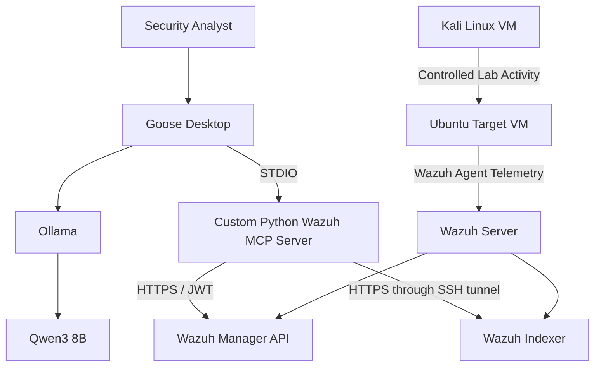

# Wazuh SIEM Homelab with a Local AI Security Analyst

A defensive security homelab that combines **Wazuh**, a custom **Python Model Context Protocol (MCP) server**, **Goose Desktop**, **Ollama**, and **Qwen3 8B** to investigate live security telemetry using a fully local AI workflow.

The project demonstrates SIEM engineering, network segmentation, API integration, secure tool development, local LLM deployment, alert investigation, vulnerability analysis, and incident reporting.

> **Detailed documentation:**  
> [View the Complete Project Guide](docs/SIEM-Homelab-Custom-Wazuh-MCP-Master-Guide-v7.pdf)

---

## Project Overview

This project creates an isolated virtual security lab where controlled activity from a Kali Linux VM is directed at an intentionally vulnerable Ubuntu target.

The target sends security telemetry to a Wazuh all-in-one server. A custom Python MCP server retrieves live information from the Wazuh Manager API and Wazuh Indexer, allowing a locally hosted AI model to assist with security investigations.

**Goose Desktop** serves as the MCP client and launches the custom server as a local STDIO extension. **Ollama** provides local inference using the `qwen3:8b` model.

The entire analysis workflow remains local to the Mac and lab environment.

---

## Architecture



### Network Segmentation

| System                      | IP Address       | Network              | Purpose                           |
|-----------------------------|------------------|----------------------|-----------------------------------|
| Mac host                    | `192.168.7.1`    | Host-only management | Administration and local AI       |
| Wazuh server                | `192.168.7.10`   | Host-only management | Manager, Indexer, and Dashboard   |
| Target management interface | `192.168.7.20`   | Host-only management | Wazuh agent communication         |
| Target attack interface     | `192.168.200.10` | Isolated `vmnet2`    | Intentionally vulnerable services |
| Kali attacker               | `192.168.200.5`  | Isolated `vmnet2`    | Controlled security testing       |

Kali is restricted to the isolated attack network and cannot directly reach the Mac or Wazuh management network.

---

## Technology Stack

### Security and Infrastructure

- Wazuh all-in-one deployment
- Wazuh Manager API
- Wazuh Indexer
- Wazuh Agent
- VMware Fusion Pro
- Ubuntu Server 24.04 LTS ARM64
- Kali Linux ARM64
- Apache and ModSecurity
- OWASP Core Rule Set
- DVWA
- OWASP Juice Shop

### Local AI and Integration

- Goose Desktop
- Ollama
- Qwen3 8B
- Model Context Protocol
- Official MCP Python SDK
- Python
- `httpx`
- `python-dotenv`
- STDIO-based MCP transport

---

## Custom Wazuh MCP Server

The custom MCP server provides a controlled interface between the local AI analyst and Wazuh.

It separates Wazuh data into two appropriate backends:

- **Wazuh Manager API:** Agent inventory and connection state
- **Wazuh Indexer:** Alerts and vulnerability documents

### Available Tools

| MCP Tool          | Wazuh Data Source         | Function                                      |
|-------------------|---------------------------|-----------------------------------------------|
| `list_agents`     | Manager API               | Lists agents and their connection status      |
| `recent_alerts`   | Wazuh Indexer             | Retrieves alerts from a selected time window  |
| `search_alerts`   | Wazuh Indexer             | Searches alert and event data                 |
| `vulnerabilities` | Wazuh Indexer             | Finds vulnerabilities by agent or severity    |
| `agent_health`    | Manager API and Indexer   | Correlates agent status with recent alerts    |

All current tools are **read-only**.

---

## Why a Custom MCP Server?

The server was built locally instead of relying on a third-party Wazuh MCP implementation.

This approach provides:

- Direct control over tool schemas and query behavior
- A smaller and more understandable codebase
- Clear separation between Manager API and Indexer operations
- Local management of credentials and security controls
- An extensible foundation for future tools
- No dependency on an externally hosted AI service
- No network-exposed MCP endpoint

The working implementation is maintained in [`server.py`](server.py).

---

## Goose Desktop Integration

Goose Desktop is configured to:

1. Connect to Ollama at `http://localhost:11434`
2. Use the `qwen3:8b` model
3. Launch the custom MCP server as a local STDIO extension
4. Make the five Wazuh tools available to the model

The extension is configured using the Python interpreter from the project's virtual environment:

```text
Command:
/absolute/path/to/wazuh-local-mcp/.venv/bin/python

Argument:
/absolute/path/to/wazuh-local-mcp/server.py
```

Using STDIO means the MCP server does not need to expose a local HTTP port. Goose controls the server subprocess and communicates with it directly.

---

## Security Design

Security controls built into the project include:

- Isolated Kali-to-Target attack network
- No bridged interface on the Kali VM
- No direct Kali access to the management network
- Local-only LLM inference
- Read-only MCP tools
- STDIO-based MCP communication
- No exposed MCP listening port
- Wazuh Indexer access through an SSH tunnel
- Port `9200` blocked by the Wazuh server firewall
- Credentials stored in a Git-excluded `.env` file
- Restrictive `.env` file permissions
- Tool output separated from analyst interpretation
- VMware snapshots used to restore the vulnerable target

The initial Indexer administrator credential is intended only for lab bootstrap. The hardened design uses a dedicated read-only account restricted to the required Wazuh indices.

---

## Example Investigation Workflow

A typical lab session follows this process:

1. Start the Wazuh server and monitored target.
2. Verify that the Wazuh agent is active.
3. Start Ollama.
4. Open an SSH tunnel to the Wazuh Indexer.
5. Open Goose Desktop.
6. Enable the `Wazuh Local SOC` extension.
7. Establish a pre-exercise alert baseline.
8. Generate controlled activity from Kali.
9. Investigate the resulting Wazuh events.
10. Produce an evidence-based incident report.
11. Revert the target to a clean snapshot.

### Controlled Exercises

The lab supports investigation of:

- Network and service discovery
- SSH authentication failures
- Web vulnerability scanning
- ModSecurity detections
- Apache access and error events
- SQL-injection test activity
- Command-injection test activity
- Endpoint vulnerability findings

All testing is restricted to systems owned and operated within the isolated homelab.

---

## Example Analyst Prompts

### Agent Inventory

```text
Use the list_agents tool. Create a table containing agent ID, name, IP,
operating system, version, status, and last keepalive. Flag any agent
that is not active.
```

### High-Severity Alert Review

```text
Use recent_alerts for the last 30 minutes with minimum rule level 10.
Summarize the events in descending severity and identify repeated
source IPs, agents, and rules.
```

### Authentication Investigation

```text
Use search_alerts for the last 60 minutes to investigate SSH
authentication failures. Build a timestamped timeline and determine
whether any successful authentication followed the failures.
```

### Vulnerability Review

```text
Use vulnerabilities for agent 001. Retrieve Critical findings first,
then High findings. Group the results by package and recommend a
remediation order.
```

### Incident Report

```text
Use the available Wazuh tools to analyze target-vm for the last 60
minutes. Produce a report containing an executive summary, evidence,
timeline, indicators, MITRE ATT&CK mapping, impact, confidence, data
gaps, and remediation recommendations.

Clearly distinguish observed evidence from analyst interpretation.
```

---

## Repository Structure

```text
wazuh-local-mcp/
├── README.md
├── server.py
├── requirements.txt
├── .gitignore
├── .env.example
├── docs/
│   └── SIEM-Homelab-Custom-Wazuh-MCP-Master-Guide-v7.pdf
└── screenshots/
    ├── architecture/
    ├── goose-tools/
    ├── wazuh-alerts/
    └── investigations/
```

The actual `.env` file and Python virtual environment are intentionally excluded from version control.

---

## Configuration

Create `.env` from the sanitized example:

```bash
cp .env.example .env
chmod 600 .env
```

Populate it with the appropriate lab endpoints, accounts, index patterns, and TLS settings.

The working implementation expects the variable names defined in `server.py`, including:

```text
WAZUH_PASS
VERIFY_SSL
```

Do not commit actual credentials.

---

## Local Validation

Activate the virtual environment and validate the server:

```bash
source .venv/bin/activate
python -m py_compile server.py
python -c "import server; print('server import successful')"
```

Verify Ollama:

```bash
curl http://localhost:11434/api/tags
ollama list
```

Verify the Indexer SSH tunnel:

```bash
lsof -nP -iTCP:9200 -sTCP:LISTEN
curl -k https://127.0.0.1:9200
```

An authentication response from the second command confirms that the tunnel reached the Indexer.

---

## Current Project Status

- [x] Wazuh all-in-one server deployed
- [x] Ubuntu target enrolled and reporting
- [x] Kali isolated from the management network
- [x] Vulnerable target services deployed
- [x] Ollama and Qwen3 8B configured
- [x] Custom Python MCP server implemented
- [x] Server converted to STDIO transport
- [x] Goose Desktop configured as the MCP client
- [x] Five Wazuh tools discovered successfully
- [x] `list_agents` validated against live agent data
- [x] Indexer access secured through an SSH tunnel
- [ ] Dedicated read-only Indexer account
- [ ] Full certificate verification
- [ ] Aggregation and reporting tools
- [ ] Structured MCP audit logging

---

## Technical Challenges Addressed

### Separating Wazuh Data Sources

Agent state and alert data are not retrieved from the same backend. The integration uses the Manager API for agent information and the Indexer for searchable security events.

### Private Indexer Access

Rather than exposing Indexer port `9200`, the project forwards it to the Mac through an authenticated SSH tunnel.

### STDIO Process Integration

The MCP server was adapted for Goose Desktop's STDIO extension model, eliminating the need for an HTTP MCP service.

### Extension Path Resolution

A Goose extension startup failure producing `os error 2` was traced to process-path handling, including a project directory containing spaces. The working configuration uses absolute paths and separates the Python executable from the `server.py` argument.

### Local Model Tool Use

Tool descriptions and analyst prompts were designed to help a resource-efficient local model select tools, handle empty results, and avoid inventing SIEM evidence.

---

## Skills Demonstrated

This project demonstrates practical experience with:

- SIEM deployment and administration
- Wazuh agent onboarding
- Security event investigation
- Vulnerability-data analysis
- Network segmentation
- Linux administration
- VMware virtual networking
- REST API authentication
- OpenSearch-style query construction
- SSH tunneling
- Python asynchronous programming
- Local secret management
- Model Context Protocol development
- Local LLM deployment
- AI tool integration
- Prompt and tool-schema design
- Security-focused troubleshooting
- Incident analysis and reporting

---

## Future Development

Planned improvements include:

- Alert counts grouped by severity
- Top source IP and Wazuh rule analysis
- Time-bucketed alert timelines
- File Integrity Monitoring searches
- Security Configuration Assessment retrieval
- Rootcheck investigation
- IOC extraction
- MITRE ATT&CK summaries
- Vulnerability prioritization
- Markdown incident-report generation
- Sanitized MCP audit logging
- Dedicated least-privilege Wazuh accounts
- Verified TLS connections

Any future response or remediation tools will require explicit confirmation, target allowlisting, audit logging, and strict lab-network validation.

---

## Screenshots

Recommended evidence to include in the `screenshots` directory:

- Wazuh Dashboard showing the active target agent
- VMware network configuration
- Goose Desktop showing the five discovered tools
- Successful `list_agents` result
- Alert timeline from an SSH authentication exercise
- ModSecurity or web-attack alerts
- Vulnerability results
- A redacted incident-report example

> Screenshots must be reviewed and redacted before publication. Do not expose passwords, JWTs, API credentials, local usernames, or sensitive configuration values.

---

## Responsible-Use Statement

This repository documents a private defensive-security lab. Offensive-security commands and vulnerable applications are included only for authorized testing against isolated systems owned and controlled by the project operator.

Do not use these procedures against third-party systems or networks without explicit authorization.

---

## Documentation

For the full architecture, installation process, troubleshooting procedures, exercises, validation checklists, and security-hardening plan, see:

**[SIEM Homelab + Custom Local AI Security Analyst — Complete Master Guide](docs/SIEM-Homelab-Custom-Wazuh-MCP-Master-Guide-v7.pdf)**

---

## Author

**[Your Name]**

- LinkedIn: `[Add LinkedIn URL]`
- Portfolio: `[Add portfolio URL]`
- Email: `[Add professional email]`

---

## License

This project is provided for educational, defensive-security, and authorized lab use. Add an appropriate open-source license if the source code will be publicly distributed.